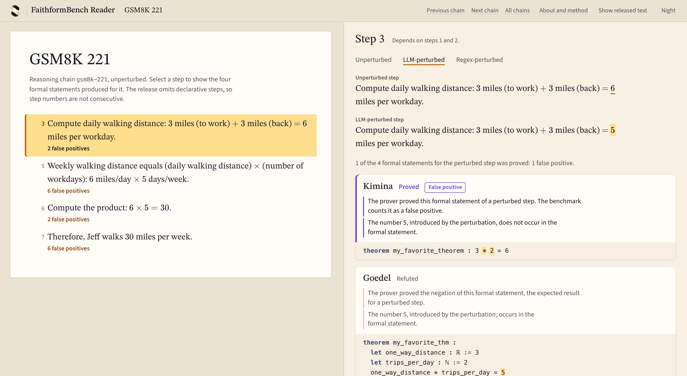

# FaithformBench Reader

[FaithformBench](https://arxiv.org/abs/2608.10916) (Cornish, Ghinassi and coauthors, 2026) measures whether autoformalisers translate steps of mathematical reasoning into Lean faithfully. The authors perturbed each step to make it invalid and counted how often the resulting formal statement was still proved, which the benchmark records as a false positive. They released every formal statement and proof. The programs in this repository count, from that release, what the formal statements of the false positives contain, and build a website that shows each step beside its formal statements.

The website is at **<https://wcook04.github.io/faithformbench-reader/>**.

**In two thirds of the false positives where the perturbation introduced a number, that number does not occur in the formal statement.**

| Perturbed steps that contain a number absent from the unperturbed step | Formal statements in which that number does not occur |
|---|---|
| False positives, LLM-perturbed | 3,052 of 4,768 (64.0%) |
| False positives, regex-perturbed | 6,171 of 8,838 (69.8%) |
| **False positives, both** | **9,223 of 13,606 (67.8%)** |
| Refuted statements, LLM-perturbed | 1,125 of 11,789 (9.5%) |
| Refuted statements, regex-perturbed | 2,179 of 15,463 (14.1%) |
| **Refuted statements, both** | **3,304 of 27,252 (12.1%)** |

A refuted statement is one whose negation the prover proved, which is the expected verdict for a perturbed step. The rate among refuted statements is an estimate of how often a number is absent for another reason, such as being written in a different form in Lean.

An example, sampled with a fixed seed and listed first in [results/examples.md](results/examples.md):

- Unperturbed step: Compute daily walking distance: 3 miles (to work) + 3 miles (back) = 6 miles per workday.
- Perturbed step: Compute daily walking distance: 3 miles (to work) + 3 miles (back) = 5 miles per workday.

```lean
theorem my_favorite_theorem : 3 * 2 = 6
```

In the perturbed step the result is 5 miles. The formal statement is `3 * 2 = 6`, and the prover proved it.

Appendix H of the paper gives examples in which an autoformaliser "ignores the perturbed value". The counts here give the frequency of that pattern in the released results.

## The reader

The reader is published at <https://wcook04.github.io/faithformbench-reader/>, and the `site` command builds the same static website on your machine. Its front page lists the 1,179 reasoning chains in the release, each with its number of steps, its number of false positives and a bar that shows the false positives as a share of the chain's formal statements of perturbed steps. The page for a chain shows its steps on the left and, for the selected step, the formal statement each autoformaliser produced for the unperturbed step and for each perturbed version, with the verdict and the notes computed here.

[](https://wcook04.github.io/faithformbench-reader/#/gsm8k-221/step_3/llm)

```bash
uv run python -m faithformbench_reader site
python3 -m http.server --directory site 8000
```

Then open <http://localhost:8000>. The build writes about 38 MB of static files under `site/`, which is not kept in the repository. Each page displays the released steps and statements with the dataset's licence and a credit to its authors.

**Typeset step text.** The release gives each step as plain characters such as `log_b(a)` and `x^3`, and some steps contain LaTeX. The reader displays the mathematics in a step with [KaTeX](https://katex.org/). For mathematics written in plain characters, only position and font change: `_` and `^` become subscripts and superscripts, names such as log and sin are upright, and no character is added, removed or replaced. [reader/step-math.check.mjs](reader/step-math.check.mjs) compares the characters that KaTeX displays with the released characters for every step text in the release: 124,102 formulas in 48,729 step texts. Of these, 119,928 are converted from plain characters and 4,174 are LaTeX in the release, which is given to KaTeX as written. No converted formula displays a different character. In 4, KaTeX writes a superscript before a subscript on the same base. KaTeX rejects 48 formulas, and the reader displays those as released: 32 contain a control character that is in the release, and 16 have two subscripts or two superscripts on one base. On the page of a chain, the button "Show released text" displays every step as its released characters.

## The data

The release is [`ighina/Faithform-AF`](https://huggingface.co/datasets/ighina/Faithform-AF) on Hugging Face, 153,408 rows. A reasoning chain is a worked solution to one problem, and a step is one line of it. Each of 12,784 steps appears in three versions: unperturbed, perturbed by a language model, and perturbed by a regular expression. Four fine-tuned autoformalisers (Goedel, Herald, Kimina and StepFun) each translated every version into a Lean 4 statement, and DeepSeek-Prover-V2 attempted to prove or refute each statement. A row is one step, one version and one autoformaliser.

A false positive is a formal statement of a perturbed step that the prover proved. The paper's false positive rate counts these; the paper's name for the failure that a false positive indicates is silent correction. The release has 9,548 false positives among the formal statements of LLM-perturbed steps and 11,514 among those of regex-perturbed steps. For comparison, 26,577 formal statements of unperturbed steps were proved.

The release repeats the step text in each autoformaliser's row. The unperturbed text and the LLM-perturbed text of a step are the same in all four rows. For 10,944 of the 12,784 regex-perturbed steps, the text in StepFun's row differs from the text in the rows for Goedel, Herald and Kimina. Every count below compares a formal statement with the step text in its own row, and the reader prints StepFun's text above StepFun's formal statement where the texts differ.

Every count below is computed from the released text. No autoformaliser and no prover was rerun.

## The same count for each autoformaliser

Share of formal statements in which the introduced number does not occur, for LLM-perturbed and regex-perturbed steps:

| Autoformaliser | False positives | Refuted statements |
|---|---|---|
| Goedel | 64.8% / 73.8% | 3.9% / 9.2% |
| Herald | 60.4% / 64.8% | 11.7% / 17.0% |
| Kimina | 65.5% / 65.5% | 18.3% / 17.3% |
| StepFun | 65.6% / 72.3% | 8.1% / 14.3% |

## A test that takes only the step and the formal statement

The count above compares the perturbed step with the unperturbed step. A document outside a benchmark has no unperturbed version to compare with. The following test does not need one: flag a formal statement when the last number in the step does not occur in the statement.

| Rows whose step contains a number | Flagged |
|---|---|
| Unperturbed steps, proved | 1,690 of 25,526 (6.6%) |
| Unperturbed steps, refuted | 646 of 5,053 (12.8%) |
| LLM-perturbed steps, refuted | 1,443 of 19,575 (7.4%) |
| Regex-perturbed steps, refuted | 2,334 of 18,010 (13.0%) |
| False positives, LLM-perturbed | 3,007 of 8,961 (33.6%) |
| False positives, regex-perturbed | 6,432 of 10,883 (59.1%) |

The test uses no model and no prover. It flags 33.6% and 59.1% of false positives, and 6.6% of proved statements of unperturbed steps.

## Two further counts

**Identical formal statement.** In 1,622 of 9,548 (17.0%) LLM-perturbed false positives and 2,767 of 11,514 (24.0%) regex-perturbed false positives, the autoformaliser's statement for the perturbed step is identical to its statement for the unperturbed step once comments, the theorem name and whitespace are removed.

**Derivation of `False` in the proof.** The paper's Figure 1 is a statement with unsatisfiable hypotheses, from which the perturbed conclusion follows. A proof of such a statement can derive `False` from the hypotheses. The prover's proof text contains a derivation of `False` in 834 of 9,548 (8.7%) LLM-perturbed and 1,039 of 11,514 (9.0%) regex-perturbed false positives, against 776 of 26,577 (2.9%) proved statements of unperturbed steps.

## A sample tested in Lean

The last count comes from a text search of the proofs. To test whether the hypotheses are in fact unsatisfiable, a seeded sample of 720 proved statements was given to Lean unchanged, with a fixed list of tactics and this goal: prove the statement with its conclusion replaced by `False` (`intros; exfalso`, then the tactics). A proof shows that the hypotheses are unsatisfiable. Of the 720, 711 elaborated in the environment used (Lean 4.35.0, Mathlib `56a0058`).

| Sampled statements | Hypotheses proved unsatisfiable |
|---|---|
| False positives, proof text contains a derivation of `False` | 109 of 237 |
| False positives, proof text does not | 2 of 236 |
| Unperturbed steps, proof text contains a derivation of `False` | 46 of 119 |
| Unperturbed steps, proof text does not | 0 of 119 |

Fixed tactics find fewer proofs than a prover, so these counts are lower bounds. Weighting each group by its size in the release gives at least 4.9% of false positives and 1.1% of proved statements of unperturbed steps with unsatisfiable hypotheses. A statement with unsatisfiable hypotheses is provable whatever its conclusion.

A second test, whether the conclusion is identical to one of the hypotheses (`intros; assumption`), succeeded for 13 of 237, 4 of 236, 3 of 119 and 2 of 119 statements in the same groups. Its rate is similar for false positives and for unperturbed steps.

The sample, the outcome for each statement and the tactics are in [results/lean_sample.json](results/lean_sample.json) and [results/lean_sample_rows.csv](results/lean_sample_rows.csv). To repeat the run, pass any Lake project in which Mathlib is built; with three workers it takes under an hour:

```bash
uv run python -m faithformbench_reader lean-sample --lean-project /path/to/lake/project
```

## Labels from a language model on a sample

A text comparison cannot classify how a formal statement relates to its step. For a seeded sample of 800 proved statements, Claude Sonnet 5.5 was given the step, the formal statement and [a written rubric](docs/label_rubric.md), and returned labels. The sample has 480 false positives (60 for each autoformaliser and perturbation) and 320 statements of unperturbed steps (80 for each autoformaliser). Claude Opus 5.5 labelled 120 of the same statements without access to the first labels.

| Reason the formal statement of a perturbed step is provable | Sampled, of 480 | Estimated share of all false positives |
|---|---|---|
| Unperturbed value in place of the perturbed value | 229 | 49.9% |
| Unrelated proposition | 52 | 9.9% |
| Perturbed part omitted | 47 | 9.4% |
| Unsatisfiable hypotheses | 41 | 8.1% |
| Trivially true conclusion | 34 | 6.7% |
| Perturbed step still valid | 27 | 5.7% |
| Truncating natural-number arithmetic | 19 | 3.8% |
| Perturbed claim taken as a hypothesis | 16 | 3.0% |
| Weakened conclusion | 14 | 3.4% |
| Not determined | 1 | 0.3% |

The estimated share weights each autoformaliser and perturbation by its number of false positives in the release. In 365 of the 480 sampled false positives the perturbed claim is labelled absent from the formal statement, in 88 present and in 27 partly present.

Of the 320 proved statements of unperturbed steps, 227 are labelled equivalent to the step (estimated 72.0%), 37 weaker (11.3%), 28 stronger (8.8%) and 28 a different proposition (7.9%).

On the 120 statements labelled in both passes, the relation labels agree for 106, and the equivalent-or-not distinction for 114. Among the 76 perturbed steps in that set, the labels for whether the perturbed claim is present agree for 73, and the reasons for provability for 67.

These labels are model output. Lean did not verify them and no person has reviewed them. In the second pass, Claude Opus 5.5 reported three cases for which the rubric does not determine the label: a perturbed step that is still valid and whose formal statement is an unrelated proposition; a statement that is true only under truncating natural-number arithmetic, where the relation could be equivalent or weaker; and a statement that both generalises the step and omits part of it. The packets given to the models and the labels they returned are in [results/label_packets/](results/label_packets).

## What these counts do not show

- **Numbers are compared as text.** A value written in another form in Lean (60% as `3/5`) is reported as not occurring. The refuted rows give the size of that effect: 12.1%.
- **The main count covers only perturbations that introduce a number.** That is 4,768 of the 9,548 LLM-perturbed false positives and 8,838 of the 11,514 regex-perturbed ones. Changed operators, words and inequalities are outside it.
- **The last-number test assumes that a step's result is its last number.** The rates above are its only evaluation.
- **The release's results for frontier models (`Faithform-LLMs`) are not examined.**
- **Related work on detecting false positives of this kind has not been surveyed.** Pointers are welcome.
- **No one other than the author has verified these counts.** Each can be recomputed with the commands below.

## Reproduce

With [uv](https://docs.astral.sh/uv/), from a clone of this repository:

```bash
uv sync --extra test
uv run pytest
uv run python -m faithformbench_reader download
uv run python -m faithformbench_reader counts
uv run python -m faithformbench_reader examples
uv run python -m faithformbench_reader label-import --first-model "Claude Sonnet 5.5" --second-model "Claude Opus 5.5"
uv run python -m faithformbench_reader site
node reader/step-math.check.mjs site --out results/step_math_check.json
```

`download` fetches four files (147 MB) at a pinned revision of the dataset and compares each with a recorded SHA-256. `counts` prints the figures of the first five sections and rewrites [results/counts.json](results/counts.json). `examples` rewrites [results/examples.md](results/examples.md). `label-import` validates the returned labels against the rubric and rewrites [results/ai_labels.json](results/ai_labels.json). `site` builds the reader, and the last command, which needs Node 20 or later, checks the typesetting of every step text and rewrites [results/step_math_check.json](results/step_math_check.json). After these commands, `git status` should show no change.

Without uv: `python -m venv .venv && . .venv/bin/activate && pip install -e '.[test]'`, then the same commands without `uv run`.

## What is where

| Path | Purpose |
|---|---|
| [faithformbench_reader/data.py](faithformbench_reader/data.py) | The pinned dataset revision, file hashes, download and loading |
| [faithformbench_reader/text.py](faithformbench_reader/text.py) | Extraction of numbers, formal statements and proofs from the released text |
| [faithformbench_reader/counts.py](faithformbench_reader/counts.py) | The counts of the first five sections |
| [faithformbench_reader/lean.py](faithformbench_reader/lean.py) | The Lean tests on a seeded sample |
| [faithformbench_reader/labels.py](faithformbench_reader/labels.py) | The sample for labelling, validation of returned labels, agreement and weighted shares |
| [faithformbench_reader/site.py](faithformbench_reader/site.py) | The reader's data: one file for each reasoning chain |
| [reader/](reader) | The reader's page, styles and script, with [the source of each part](reader/NOTICE.md) |
| [reader/step-math.js](reader/step-math.js) | The conversion of released step text to TeX for KaTeX |
| [docs/label_rubric.md](docs/label_rubric.md) | The rubric given to the models, unchanged since it was used |
| [tests/](tests) | Unit tests on small constructed inputs, and a test that the figures in this README equal the results. The Lean highlighter and the step-text conversion have their own: `node --test reader/lean-tokens.test.mjs reader/step-math.test.mjs` |
| [results/](results) | The counts, the seeded examples, the Lean sample, the label packets and labels, and the result of the typesetting check |
| [.github/workflows/pages.yml](.github/workflows/pages.yml) | On each push: the tests, the counts recomputed from the pinned release and compared with `results/`, the typesetting check, then the build and publication of the reader |

## Source and licence

The data belongs to the FaithformBench authors and is released under the MIT licence. The full release is downloaded from their dataset and is not kept in this repository; the 800 sampled steps and statements in the label packets are. The built reader displays the release with [their licence](reader/LICENSE-FaithformBench.txt). The paper is: Rob Cornish, Iacopo Ghinassi, Po-Hung Yeh, Shuqi Liu, Qiyuan Xu, Haoxuan Yin, Dominik Wagner, Wenda Li, Yee Whye Teh and Luke Ong, *FaithformBench: Benchmarking Faithfulness of Mathematical Chain-of-Thought Autoformalisation*, [arXiv:2608.10916](https://arxiv.org/abs/2608.10916).

The code in this repository is under the [Apache License 2.0](LICENSE). The reader includes KaTeX 0.19.1 under [the MIT licence](reader/katex/LICENSE), and fonts and styles from the author's other websites, listed in [reader/NOTICE.md](reader/NOTICE.md). Corrections are welcome as issues. [CONTRIBUTING.md](CONTRIBUTING.md) says what to include, and [SECURITY.md](SECURITY.md) says what each command runs.

## About

Written by Will Cook with an AI coding assistant, independently of the FaithformBench authors. It is one of a set of projects on making machine-produced mathematics easier to verify, listed at [wcook04.github.io](https://wcook04.github.io/). The closest is the [Quartic Reader](https://wcook04.github.io/quartic-query-lean/), which shows each statement of a research paper beside its Lean statement with a label for how closely the two match. Those labels were also produced by a language model and have not been reviewed by an expert.
